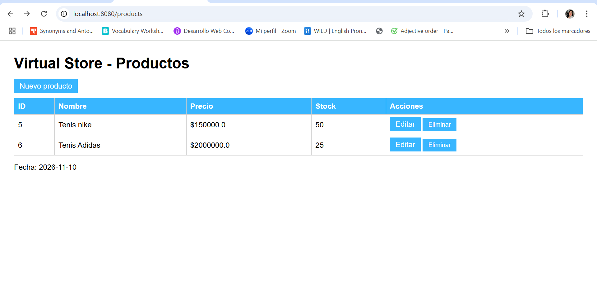
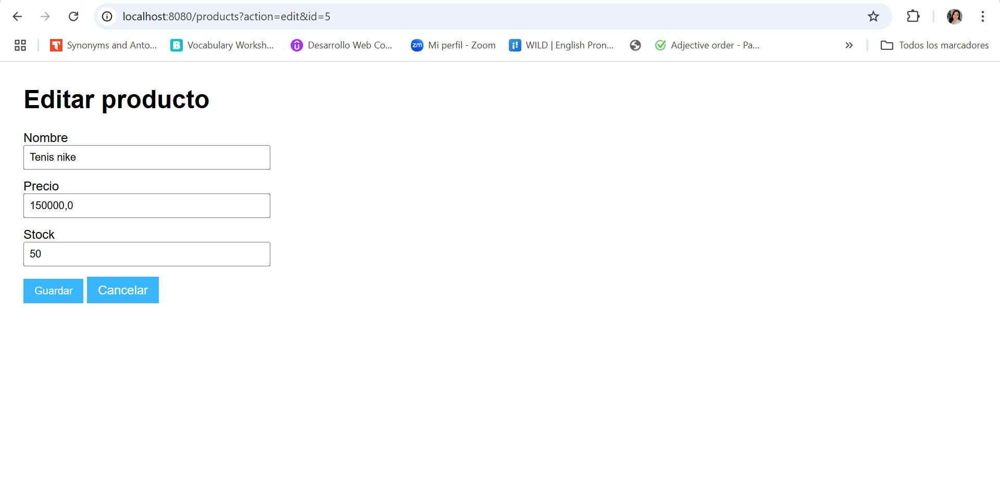
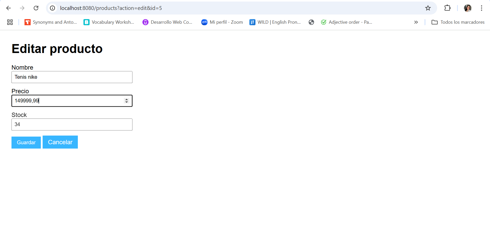
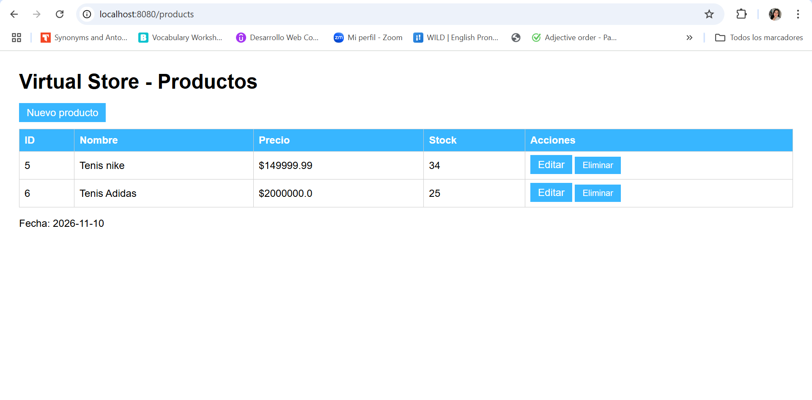

<div align="center">

# 🛒 Virtual Store

### Módulo web de gestión de productos con Java Servlets y JSP


**Evidencia GA7-220501096-AA2-EV02 · Módulos de software codificados y probados**

</div>

---

## 📌 Descripción

**Virtual Store** es una aplicación web desarrollada en Java que permite administrar los productos de una tienda virtual mediante las cuatro operaciones básicas de datos: **crear, consultar, actualizar y eliminar (CRUD)**.

El módulo está organizado por capas: los **Servlets** reciben y procesan las solicitudes HTTP, los **JSP** presentan las interfaces al usuario, los **DAO** acceden a la base de datos mediante **JDBC** y la información se almacena en **SQLite**.

## 🎯 Objetivo

Codificar y probar un módulo de software orientado a la web, aplicando formularios HTML con Servlets, los métodos HTTP **GET** y **POST** y elementos de **JSP**, según lo visto en el componente formativo *Construcción de aplicaciones con Java*.

## ✨ Funcionalidades

| Funcionalidad | Método HTTP | Descripción |
|---|---|---|
| Listar productos | `GET` | Muestra la tabla con ID, nombre, precio y stock. |
| Abrir formulario de nuevo producto | `GET` | Presenta el formulario vacío. |
| Abrir formulario de edición | `GET` | Carga los datos del producto seleccionado. |
| Registrar producto | `POST` | Valida y guarda un producto nuevo. |
| Actualizar producto | `POST` | Guarda los cambios de un producto existente. |
| Eliminar producto | `POST` | Elimina el producto previa confirmación del usuario. |

## 🧰 Tecnologías

| Componente | Tecnología |
|---|---|
| Lenguaje | Java 17 |
| Aplicación web | Java Servlets (`javax.servlet` 4.0.1) y JSP con JSTL 1.2 |
| Interfaz | HTML5 y CSS |
| Base de datos | SQLite con JDBC (`sqlite-jdbc` 3.50.3.0) |
| Gestor del proyecto | Apache Maven |
| Servidor de ejecución | Jetty (`jetty-maven-plugin` 9.4.54) |
| Entorno de desarrollo | Visual Studio Code |
| Control de versiones | Git y GitHub |

## 🗂️ Estructura del proyecto

```text
YENNIFERMEJIA_AA2_EV02/
├── evidencias/                      # Capturas de pantalla de la evidencia
├── src/
│   └── main/
│       ├── java/com/virtualstore/
│       │   ├── dao/
│       │   │   └── ProductDAO.java          # Operaciones CRUD con JDBC
│       │   ├── database/
│       │   │   ├── DatabaseConnection.java  # Conexión a SQLite
│       │   │   └── DatabaseInitializer.java # Creación de las tablas
│       │   ├── model/
│       │   │   └── Product.java             # Entidad Producto
│       │   ├── servlet/
│       │   │   └── ProductServlet.java      # doGet() y doPost()
│       │   ├── CrudDemo.java                # Prueba del CRUD por consola
│       │   └── Main.java
│       └── webapp/
│           ├── index.jsp                    # Página de entrada
│           ├── product-list.jsp             # Listado de productos
│           └── product-form.jsp             # Formulario crear / editar
├── .gitignore
├── enlace_repositorio.txt
├── pom.xml
├── README.md
└── tienda_virtual.db                        # Base de datos SQLite
```

## 🏗️ Arquitectura

```text
Navegador ──► ProductServlet ──► ProductDAO ──► SQLite
                  │  (doGet / doPost)   (JDBC)
                  ▼
             JSP (vista)
```

1. El usuario envía una solicitud desde el navegador (enlace con `GET` o formulario con `POST`).
2. `ProductServlet` interpreta el parámetro `action` y llama al DAO.
3. `ProductDAO` ejecuta la consulta con `PreparedStatement` sobre SQLite.
4. El servlet entrega los datos al JSP correspondiente, o redirige al listado después de un `POST`.

## 🗄️ Base de datos

El archivo `tienda_virtual.db` se crea y se inicializa automáticamente con las tablas `User`, `Product`, `Order` y `Order_items`, según el modelo entidad-relación del proyecto.

Este módulo trabaja con la tabla **`Product`**:

| Columna | Tipo | Descripción |
|---|---|---|
| `product_id` | INTEGER (PK, autoincremental) | Identificador del producto |
| `name` | TEXT | Nombre |
| `price` | REAL | Precio |
| `stock` | INTEGER | Unidades disponibles |

## 🚀 Cómo ejecutar el proyecto

**Requisitos:** Java JDK 17 o superior y Apache Maven.

```bash
# 1. Clonar el repositorio
git clone https://github.com/Yenifer18-4200/YENNIFERMEJIA_AA2_EV02.git
cd YENNIFERMEJIA_AA2_EV02

# 2. Iniciar la aplicación con Jetty
mvn jetty:run
```

Luego abre en el navegador: **http://localhost:8080**

Para detener el servidor, pulsa `Ctrl + C` en la terminal.

## 🧪 Pruebas realizadas

| Prueba | Resultado |
|---|---|
| Listar los productos registrados | Correcto |
| Registrar un producto nuevo desde el formulario | Correcto |
| Editar nombre, precio y stock de un producto | Correcto |
| Eliminar un producto con confirmación | Correcto |

Las capturas de cada prueba están en la carpeta [`evidencias`](evidencias/).

## 🖼️ Capturas

### Listado de productos


### Edición de un producto
| Datos originales | Datos modificados | Producto actualizado |
|---|---|---|
|  |  |  |

## 🔖 Control de versiones

El proyecto se gestiona con **Git** y se aloja en **GitHub**. El enlace del repositorio también se encuentra en el archivo [`enlace_repositorio.txt`](enlace_repositorio.txt).

## 👩‍💻 Información de la evidencia

| | |
|---|---|
| **Aprendiz** | Yennifer Mejía Mendez |
| **Programa** | Tecnólogo en Análisis y Desarrollo de Software |
| **Ficha** | 3336155 |
| **Centro** | Centro de Comercio y Servicios · SENA Regional Risaralda |
| **Evidencia** | GA7-220501096-AA2-EV02 |
| **Nombre de la evidencia** | Módulos de software codificados y probados |